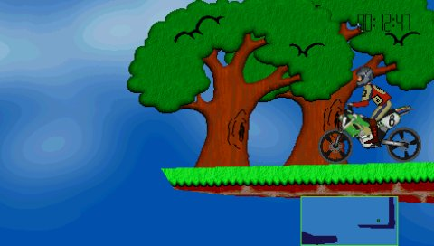
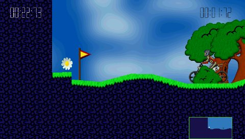
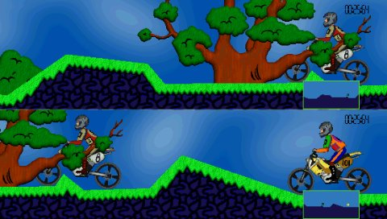
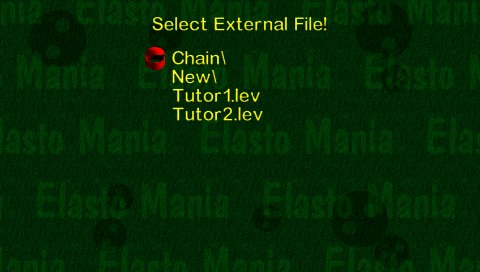
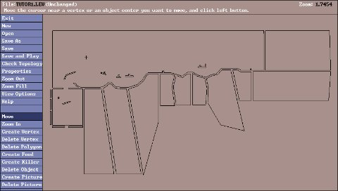

# Elasto Mania for PSP (unofficial port)

This is a PSP port of the **Elasto Mania (2000) source code** released by the
Elasto Mania Team at https://github.com/elastomania/elma-classic. The game logic
and level editor are the original code. The Windows platform layer (DirectDraw,
DirectInput, DirectSound, Win32) has been replaced with a PSP one.

It contains **no game assets**. You need the data files from your own copy
of Elasto Mania, shareware or registered.

## Screenshots

<table>
  <tr>
    <td></td>
    <td></td>
  </tr>
  <tr>
    <td align="center">Gameplay, zoomed out for the small screen</td>
    <td align="center">Timer and minimap</td>
  </tr>
  <tr>
    <td></td>
    <td></td>
  </tr>
  <tr>
    <td align="center">Split-screen multiplayer</td>
    <td align="center">Full-width menus, level subfolders</td>
  </tr>
  <tr>
    <td></td>
    <td></td>
  </tr>
  <tr>
    <td align="center">The level editor on a 480-wide screen</td>
    <td></td>
  </tr>
</table>

## Installing

1. Download `EBOOT.PBP` from the
   [Releases](https://github.com/bosshunter/elma-psp/releases) page.
   Make a folder `ms0:/PSP/GAME/ELMA/` on the memory stick and put `EBOOT.PBP`
   in it.
2. Copy everything from your Windows Elasto Mania folder into that same
   folder: `elma.res`, `state.dat`, the `lev`, `lgr` and `rec` folders.

The same `EBOOT.PBP` works with the **shareware** and the **registered**
`elma.res`: it looks at the file when it starts and becomes that version,
with that version's levels, demos, editor limits and rules. Your `state.dat`
(players, best times, key bindings) can be copied across as well, from the
same version: like on the PC, the shareware version does not accept a
registered `state.dat`. The default key
codes were chosen so that Windows bindings work unchanged (except the
minimap and timer keys, which move to D-Pad Down and D-Pad Up).

It runs on custom firmware or any homebrew-capable PSP, and in PPSSPP.

## Building

You need the [PSP toolchain](https://github.com/pspdev/pspdev) (`$PSPDEV/bin`
on your `PATH`).

```sh
mkdir build && cd build
psp-cmake ..        # or: cmake -DCMAKE_TOOLCHAIN_FILE=$PSPDEV/psp/share/pspdev.cmake ..
make
```

The output is `build/EBOOT.PBP`.

This builds the **wide editor** (see Screen). For the classic editor
stretched to the screen, configure with `psp-cmake -DELMA_WIDE_EDITOR=OFF ..`.

## Screen

- **Gameplay** is drawn at **752x426** and scaled down to 480x272, so the
  view is zoomed out (about 1.57x) and the bike no longer fills most of the
  small screen. This works for single player and split screen.
- **60 fps:** gameplay runs at 60 frames a second in single player, zoomed
  out and in split screen, and so do the menus and the intro. The level
  picture is still drawn by the CPU as in the original, straight into video
  memory; the PSP's GPU scales it to the screen and draws the bikes (from
  pre-shrunk copies of their pictures, smoothed), the menus and the intro.
  The CPU and the GPU work at the same time, and a finished frame is shown at
  the next screen refresh. To go back to the CPU drawing of v1.0 (for comparing,
  or if something looks wrong), put an empty file named `cpurajz.inf` in `ms0:/PSP/GAME/ELMA/`.
- **Zoom:** hold **R** to zoom in and **L** to zoom out while playing or
  watching a replay (in split screen too). The zoom stays as you leave it, from
  level to level, and is saved in `state.dat` when you leave a level, so it is
  the same the next time you start the game.
- **Inc. / Dec. Screen Size** are not assigned by default (Options →
  Customize controls). They shrink or enlarge the view as in the original,
  and in split screen there are two extra steps above full size: the default
  is a thin gap between the two views; Inc. at full size removes the gap, and
  Dec. widens it back to the original gap before the views start to shrink.
  The screen size and the gap are saved in `state.dat` and loaded at
  start-up.
- **Menus** use the full 480-pixel width: they are drawn on an 848x480 screen
  (the PSP's shape at 480 lines) and scaled down to 480x272 with smoothing.
  The original 640x480 layout sits in the middle and the background, the
  moving balls and the intro fill the whole width.
- **Level editor:** it has an 848x480 screen (the PSP's shape), so nothing
  is stretched and the level view is wider than the original; the dialogs sit
  in the middle. **L** switches to a 1:1 view (pixel sharp, readable small
  text) that scrolls to follow the cursor. Press L again to go back.

## Controls

**Menus**

| PSP | Action |
|---|---|
| D-Pad or left analog stick | Move through the entries |
| Cross or Start | Select (Enter) |
| Circle | Back (Esc) |
| R + D-Pad Up / Down | Page up / page down (level lists) |
| Square | Backspace in text fields; in Customize controls, unassign the highlighted control |

**In game** (these are the default bindings and can be changed in Options → Customize controls)

| PSP | Action | Windows key |
|---|---|---|
| Cross | Accelerate | Up |
| Square | Brake | Down |
| D-Pad Right | Rotate clockwise | Right |
| D-Pad Left | Rotate anticlockwise | Left |
| Circle | Turn around | Space |
| Select | Back to the menu | Esc |
| D-Pad Up | Show / hide timer | (none) |
| D-Pad Down | Show / hide minimap | (none) |
| L (hold) | Zoom out | `-` |
| R (hold) | Zoom in | `=` |
| Start | Default zoom | Enter |
| (not assigned) | Screenshot | I |

The left analog stick does the same as the D-Pad, in game as in the menus.

Make a Screenshot is not assigned by default (it was Triangle up to v1.0);
it can be set in Options → Customize controls.

Esc is split on purpose: Circle in menus, Select in game, because Circle turns
the bike around.

**Level editor**

| PSP | Action |
|---|---|
| Analog stick | Move the mouse cursor |
| D-Pad | Move the mouse cursor (a little slower than the stick pushed all the way) |
| Cross | Left mouse button |
| Circle | Right mouse button and Esc (cancel) |
| L | Toggle the 1:1 (zoomed) view |
| Start | Enter |
| Square | Backspace |
| Triangle | Space |

**Text entry.** The PSP on-screen keyboard opens for player names, external
file names, and in the editor for Save As file names, the level name,
distances and clipping (U / G / S). The text is passed to the game's own
input code, so the original length and character rules still apply. For Save
As, the keyboard fills in the name and you then click **SAVE** or **SAVE
LOCKED** (or press Start).

**Zoom In:** press Cross on one corner, hold it, move the cursor and release
Cross on the other corner. (Two separate clicks still work too.)

**Saving.** `state.dat` (players, options, controls, best times, progress) is
written when you leave the Options menu, after each finished level, when you
quit from the menu, and also when you quit with the HOME button; a changed
zoom or screen size is also saved when you leave a level. The PSP's
extra settings (the Zoom In / Zoom Out keys, the current zoom and the screen
size) are stored
after the PC data at the end of `state.dat`, so the PC game can still read
the file; if the PC game saves it, those go back to their defaults.

## Changes from the original game

- Subfolder navigation in the External level menu and in the editor (folders and 
  level file names should have up to 8 characters and no spaces).
- Wrap-around and auto-scrolling in all menus and in the editor's level list. Up on the 
  first entry goes to the last, and Down on the last goes to the first.
- The external file list has no file cap (it is also sorted with `qsort`
  now, so very large folders open quickly).
- The left stick works as the D-Pad.
- Square erases a binding in Customize controls.
- Zoomed out 480x272 gameplay view, full-width menus, PSP controls, PSP
  on-screen keyboard.
- Added zoom in and out when playing a level. Start resets the zoom.
- One build supports the shareware and the registered `elma.res` (detected
  at startup).
- Registered: locked levels can be opened in the editor after a warning, and
  a plain Save writes them unlocked. Shareware: as in the original, locked
  levels cannot be edited.
- Shareware: a level saved by the registered version gives a message and the
  game goes back, instead of quitting as the PC version did.
- `state.dat` is also saved when you leave Options and when you quit with
  HOME.
- Fixed: the demo could freeze, and the intro did not slide up on the first
  start.
- The GPU draws the bikes, the menus and the intro, and the game runs at 60
  fps (single player, zoomed out and split screen). The bikes are smoother.
- The level graphics (`.lgr`) are read faster and the default one is loaded
  during the intro picture, so the first level no longer pauses for about two
  seconds.
- Split-screen timers are bigger and easier to read.
- The screen size (Inc. / Dec. Screen Size) is saved in `state.dat` and
  loaded at start-up.
- The menu helmet glides to the selected entry (the PSP screen left a faint
  trail when it jumped).

## Source layout

| Path | Contents |
|---|---|
| `src/` | The original source with lowercase file names, forward-slash includes and the changes above |
| `platform/` | New PSP platform layer. `psp_platform.cpp` covers video (sceGu: the 8-bit picture as a CLUT texture, the GPU-drawn bikes, menus and intro, frame display), input, mouse emulation, timer, sound output (sceAudio), the on-screen keyboard, the HOME exit callback and `main()`. `psp_hhigh.cpp` is the original sound mixer |
| `compat/` | Small shims for Watcom/MSVC runtime functions and DOS-style paths |
| `build_units.txt` | The files that make up the game (the Windows build without its DOS/Windows platform code and stale copies) |
| `psp_assets/` | XMB icon (`ICON0.PNG`) and background (`PIC1.PNG`) |
| `screenshots/` | The pictures in this README |

## Known limitations

- **Memory:** the game checks for about 10 MB free at startup and says how
  much is missing if there isn't enough. On a PSP-1000 with large levels or
  `.lgr` files memory can run short. PSP-2000 and later get the extra 32 MB
  automatically. Putting an empty file called `nemmem.inf` next to
  `EBOOT.PBP` skips the startup check.
- **Speed:** the PSP CPU has no hardware double-precision floating point, and
  the game's physics uses doubles, so they run in software (the bike drawing
  uses single precision). The CPU is set to 333 MHz. The 60 fps were
  measured on the internal levels.
- **Replays recorded on PC may play back differently.** The original ran its
  physics on the x87 FPU (80-bit) and the PSP uses 64-bit doubles. Replays
  recorded on the PSP play back correctly on the PSP.
- The **Replay** menu looks for a replay's level in `lev` itself, so a replay
  of a level from a subfolder only plays if a copy of the level is in `lev`
  (otherwise the game says it cannot find the level file).
- **Split-screen multiplayer** works, but there is only one controller, so
  player 2 has no default buttons.
- The editor's other keyboard shortcuts have no buttons. Everything can be
  reached with the cursor.

## License

The game source is © the Elasto Mania Team and is used under its dual license
(see `LICENSE.md`): **Creative Commons Attribution-NonCommercial-ShareAlike 4.0**
plus the additional terms in its preamble. This port is an adaptation and is
released under the same license. It is non-commercial, it may not be used for
cheats or competitive advantage, and "Elasto Mania" is a trademark of its
owners. This port is not affiliated with or endorsed by them. The original
README is kept as `ORIGINAL_README.md`.
